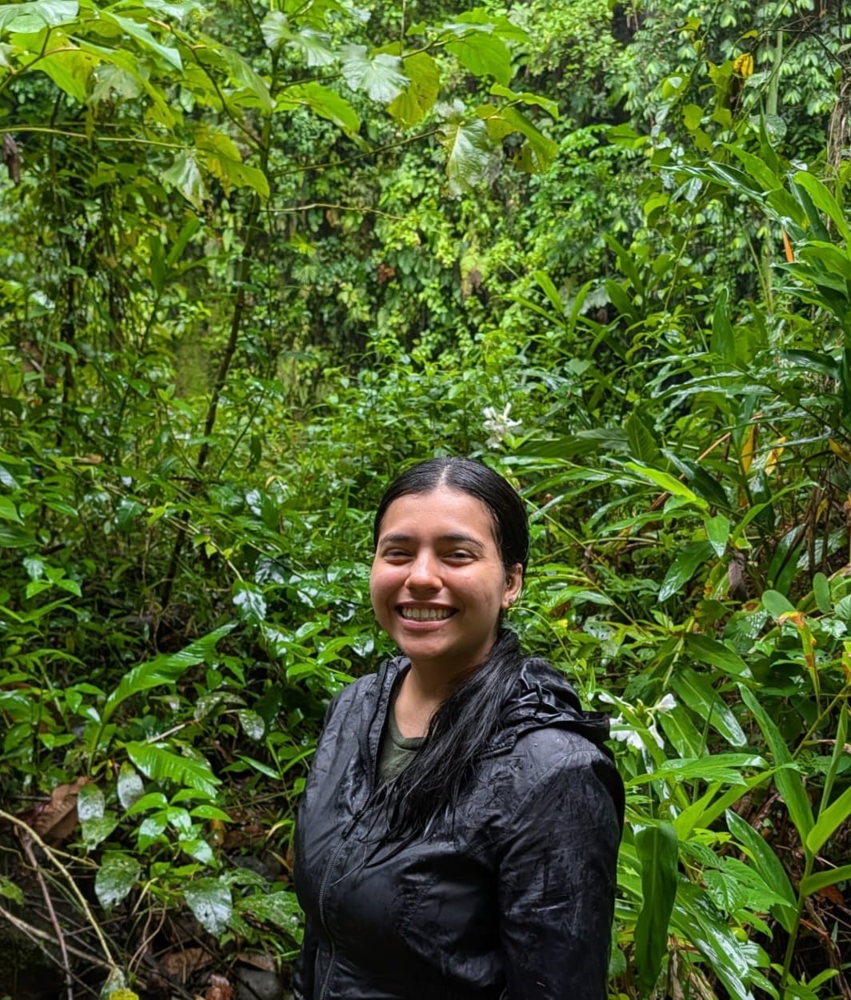

::: {.perfil-superior}

::: {.perfil-foto}

{fig-alt="Fotografía de perfil"}

:::

::: {.perfil-info}

# Hillary Arburola Rivera

## Estudiante de Bachillerato en Biología Tropical

Escuela de Ciencias Biológicas  
Universidad Nacional, Costa Rica

::: {.enlaces-perfil}

[<i class="bi bi-envelope-fill"></i> Correo](mailto:hillary.arburola.rivera@est.una.ac.cr)

[<i class="bi bi-github"></i> GitHub](https://github.com/harburola)

[<i class="bi bi-person-badge-fill"></i> ORCID](https://orcid.org/0009-0003-1462-7007)

[<i class="bi bi-linkedin"></i> LinkedIn](https://www.linkedin.com/in/hillary-arburola-rivera-504b02426)

:::

:::

:::

---

## Biografía

Esstudiante de Biología Tropical. La principal área de interés profesional es la Ecología de la Restauración enfocada en reintroducción de especies nativas y restauración de interacciones ecológicas.

---

## Áreas de interés

- Ecología
- Conservación
- Biogeografía
- Restauración ecológica
- Ciencia de datos

---

## Habilidades

- R
- Quarto
- Git y GitHub
- QGIS
- Microsoft Office

---

## Idiomas

- Inglés C1 
- Español nativo

## Formación académica

**Universidad Nacional (UNA)**

Bachillerato en Biología Tropical

*2022 – Presente*

## Formación complementaria 

- Tropical Biology Summer Course - OET 2024
- Agroecología de Hongos - North Dakota State University 2026
