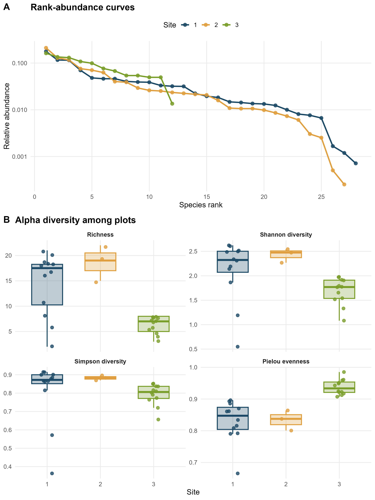
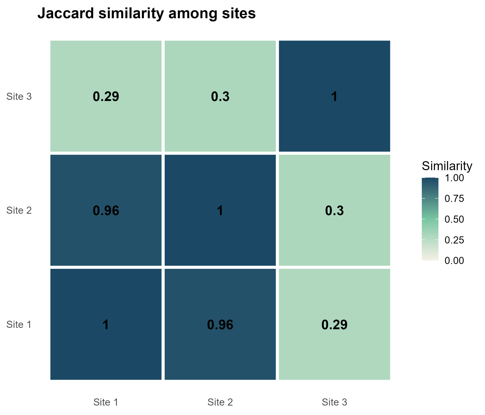

En esta práctica se mide la diversidad de comunidades vegetales en tres sitios del área del valle de Coachella, California. El objetivo de la práctica fue comparar cuántas especies se registraron, qué tan uniformes fueron sus abundancias y qué tan parecida fue la composición entre los sitios.

En RStudio, utilicé tidyverse para organizar los datos en matrices de abundancia por sitio y por parcela. Con vegan calculé la riqueza, los índices de Shannon y Simpson y la similitud de Jaccard. También calculé la equidad de Pielou y resumí la riqueza total de los tres sitios como medida de diversidad gamma. Elaboré los gráficos con ggplot2, combiné los paneles con cowplot y utilicé sf y tmap para representar el área de estudio.

Al reunir los registros por sitio, las curvas de rango-abundancia mostraron 28 especies en el sitio 1, 27 en el sitio 2 y 12 en el sitio 3 (Figura 1A). En cambio, al comparar las parcelas, el sitio 2 presentó la mediana de riqueza más alta y el sitio 1 mostró mayor variación entre parcelas. El sitio 3 tuvo la menor mediana de riqueza, pero la mayor equidad de Pielou. Es decir, en sus parcelas se registraron menos especies, pero sus abundancias estuvieron repartidas de manera más uniforme (Figura 1B).

*Figura 1. Rango-abundancia y diversidad alfa de las comunidades vegetales en tres sitios del área del valle de Coachella. (A) Curvas de rango-abundancia por sitio, con la abundancia relativa en escala logarítmica. (B) Riqueza, diversidad de Shannon y Simpson (1 − D) y equidad de Pielou por parcela. Cada punto representa una parcela.*

Los sitios 1 y 2 presentaron la mayor similitud en la composición de especies, con un índice de Jaccard de 0,96. En contraste, la similitud del sitio 3 fue de 0,29 con el sitio 1 y de 0,30 con el sitio 2 (Figura 2). Por tanto, aunque los sitios 1 y 2 no tuvieron exactamente la misma riqueza, compartieron casi todas las especies registradas entre ambos.

*Figura 2. Similitud de Jaccard entre los tres sitios de estudio, calculada a partir de la presencia y ausencia de especies. Los valores cercanos a 1 indican mayor semejanza en la composición.*

En esta práctica aprendí que una comunidad puede tener pocas especies y, aun así, presentar una alta equidad. Lo más difícil fue distinguir entre la riqueza acumulada de todo un sitio y la riqueza de cada parcela, porque ambas responden preguntas distintas. Podría aplicar estos índices en un proyecto de restauración para evaluar si las parcelas restauradas ganaron especies con el tiempo y si su composición se acercó a la de un sitio de referencia.
