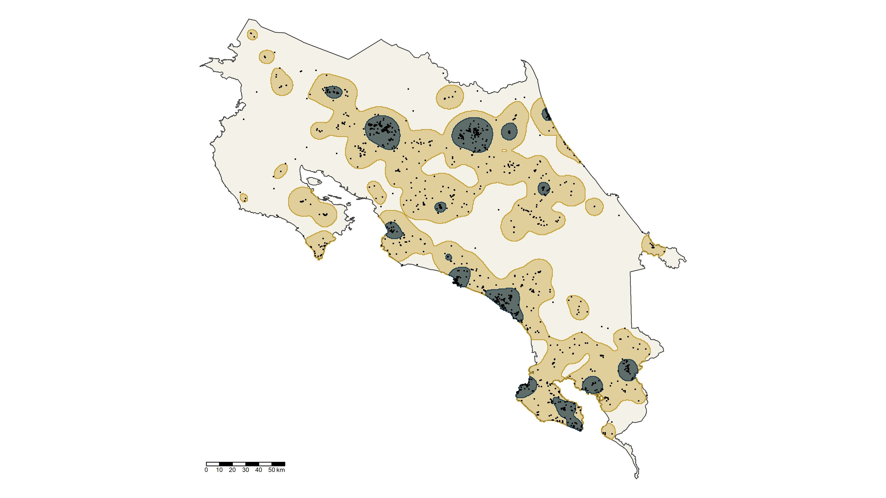

En esta práctica se usa la estimación de densidad kernel (KDE), con el objetivo de aplicar la estimación de densidad kernel (KDE) para identificar las zonas de Costa Rica con mayor concentración de localidades registradas de *Craugastor fitzingeri*. En RStudio, utilicé tidyverse para eliminar coordenadas repetidas y sf para conservar los puntos dentro del país y proyectarlos en metros. Con spatstat geom y spatstat explore estimé la densidad con un kernel gaussiano y un ancho de banda de 5 km. Finalmente, recorté la superficie al territorio nacional con terra y la representé con tmap.

El mapa mostró un foco de mayor densidad en el sector centro-norte del país. También se distinguieron concentraciones menores hacia el oeste de ese foco, a lo largo del Pacífico central y en sectores del Pacífico sur, incluida la península de Osa (Figura 1). Estas concentraciones correspondieron a localidades documentadas y pudieron estar influidas por diferencias en el esfuerzo de muestreo, por lo que no indicaron necesariamente una mayor abundancia de la especie.

*Figura 1. Densidad espacial de localidades con registros de* Craugastor fitzingeri *en Costa Rica, estimada mediante KDE con un ancho de banda de 5 km. Los puntos negros representan localidades únicas y los tonos más oscuros indican una mayor densidad estimada de localidades por km².*

Con esta práctica aprendí que a realziar KDE para una especie y a emplear diferentes anchos de banda para suavizar mi mapa. Lo más difícil fue utilizar una resolución adecuada para la especie. Podría aplicar este método en un inventario de anfibios para detectar sectores poco documentados y orientar nuevas salidas de campo.
