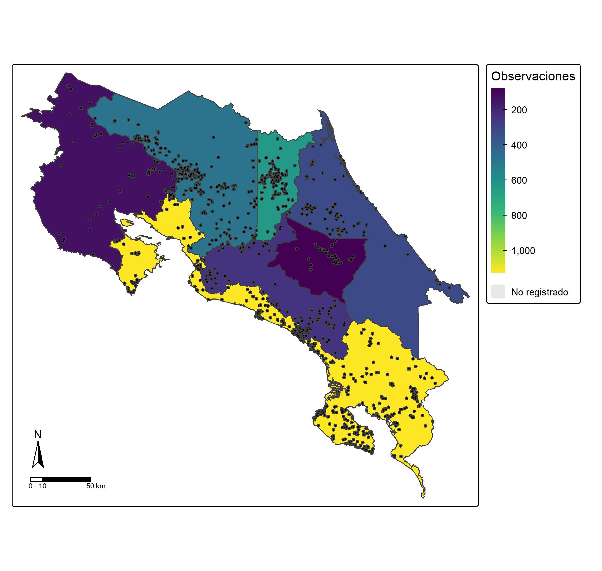
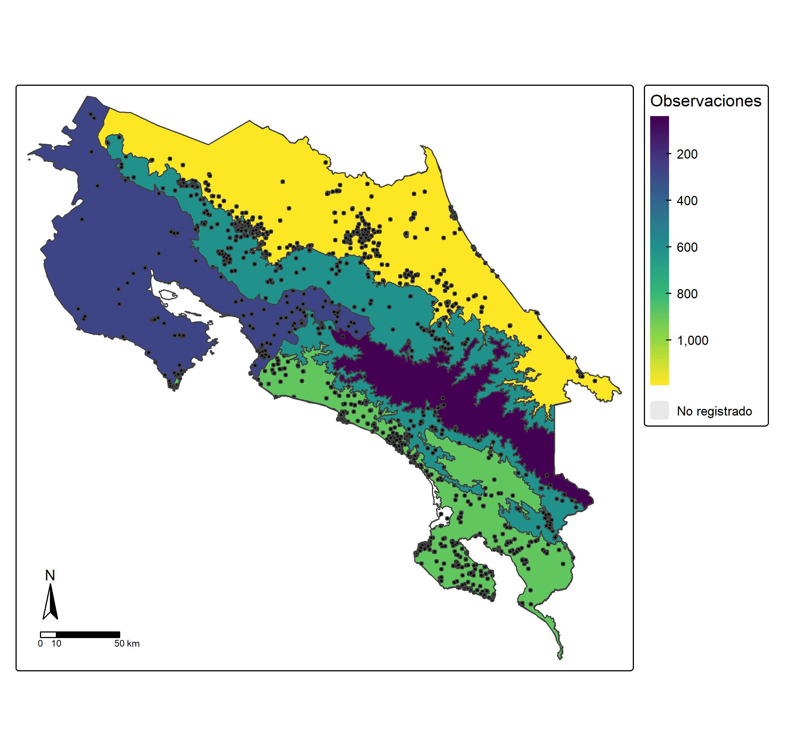
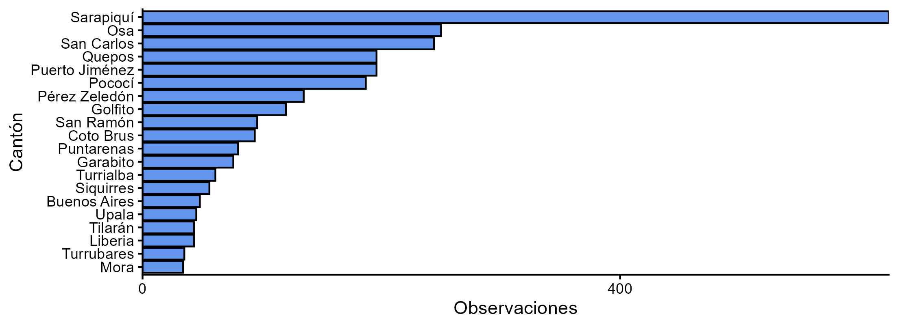

## Mapeo de zonas administrativas y zonas de vida

En esta práctica se mapean los registros de *Craugastor fitzingeri* en Costa Rica y se resumen por cantón, provincia administrativa y provincia biogeográfica de Savage. El objetivo fue identificar dónde se concentraron las observaciones y comparar cómo se representaron al usar límites administrativos o biogeográficos.

En RStudio, utilicé sf para convertir las coordenadas en puntos y cruzarlos con las capas cartográficas. Luego, con tidyverse, agrupé y conté los registros por unidad geográfica, y con tmap elaboré los mapas. Para el cruce con las provincias de Savage, el script también me permitió asignar los puntos costeros que habían quedado fuera de los límites al polígono más cercano.

El mapa por provincias administrativas mostró cómo se distribuyeron los registros de *Craugastor fitzingeri* entre las divisiones territoriales de Costa Rica (figura 1). Esta agrupación facilitó la comunicación de los resultados y permitió ubicar las observaciones en unidades que se utilizan para la planificación y la gestión territorial.

Figura 1. Mapa de observaciones de *Craugastor fitzingeri.* El mapa se encuentra dividido en las provincias de Costa Rica por cantones.

El mapa por provincias biogeográficas de Savage (Figura 2) agrupó los registros de *C. fitzingeri* según regiones que reflejan patrones de distribución de anfibios y reptiles. Esta división permitió interpretar las observaciones en el contexto de la herpetofauna costarricense, cuyos patrones de distribución no necesariamente coinciden con los límites administrativos.

Figura 2. Mapa de observaciones de *Craugastor fitzingeri* por zonas de vida de Savage.

El mapa cantonal mostró que las observaciones no se distribuyeron de manera uniforme. Un cantón del norte del país superó los 600 registros, mientras que en varios cantones del centro no se registraron observaciones en la base analizada (Figura 3). Estas diferencias reflejaron la cantidad de registros disponibles, pero no permitieron concluir que la especie fuera más abundante en los cantones con más observaciones ni que estuviera ausente en los demás.

Figura 3. Observaciones de Craugastor fitzingeri por cantones donde más registros se presentan.

Aprendí a cruzar registros de presencia con capas cartográficas y a resumirlos por área. Una dificultad fue interpretar los puntos costeros que quedaron fuera de los polígonos, porque asignarlos a la región más cercana fue una aproximación. Podría aplicar este procedimiento en un inventario de anfibios para identificar qué regiones tienen pocos registros y orientar futuros muestreos.
