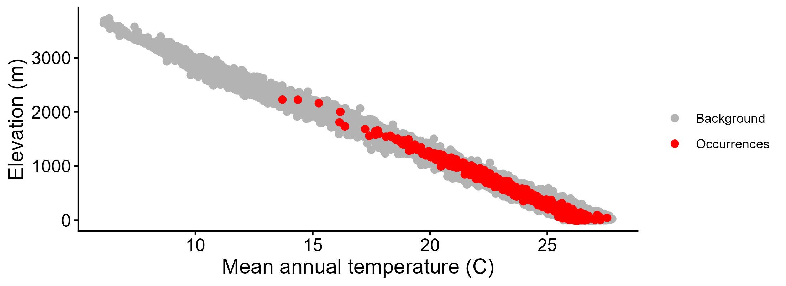
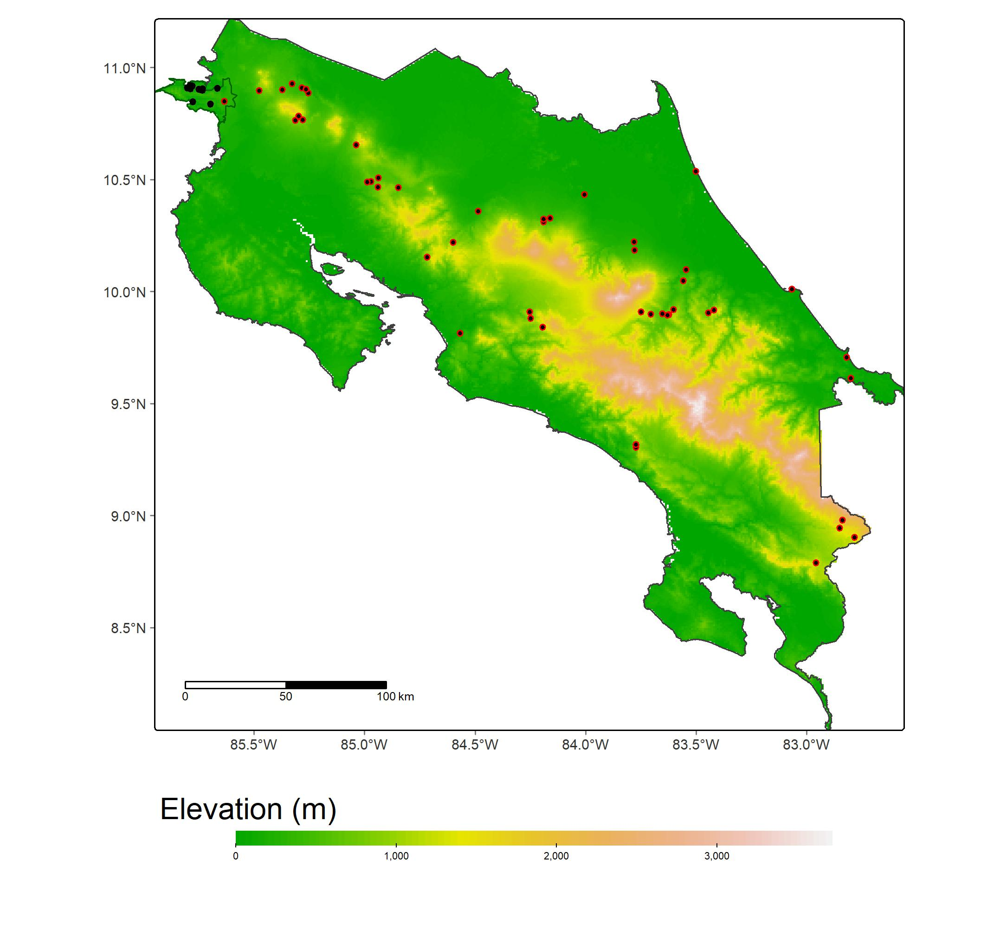

En esta práctica se explora el nicho ambiental de una especie a partir de sus registros de ocurrencia. En RStudio, utilicé sf para representar las observaciones como puntos y terra para alinear las capas de temperatura media anual, precipitación anual, elevación y huella humana, y extraer sus valores en cada sitio de registro. Con tidyverse , incluido ggplot2, preparé los gráficos, y con tmap elaboré los mapas. El objetivo fue comparar las condiciones donde se registró *Craugastor fitzingeri* con las disponibles en Costa Rica. En un segundo ejercicio se aplicó el mismo procedimiento a *Craugastor ranoides*, separando los registros anteriores al año 2000 de los registrados desde ese año.

Al comparar la temperatura con la elevación, los registros de *C. fitzingeri* se concentraron en el extremo más cálido y de menor elevación del gradiente ambiental, aunque también hubo algunas observaciones por encima de los 2 000 m (Figura 1). La relación inversa entre la temperatura y la elevación también se observó en el fondo ambiental, por lo que el gráfico no permitió separar el efecto de ambas variables.

Figura 1. Temperatura media anual (°C) y elevación (m) en los sitios con registros de *Craugastor fitzingeri* en Costa Rica. Los puntos rojos representan los registros de la especie y los grises, las combinaciones de temperatura y elevación del fondo ambiental del país.

Por otro lado, los registros de *Craugastor ranoides* anteriores al año 2000 se distribuyeron desde el noroeste hasta el sureste de Costa Rica, tanto en tierras bajas como en sectores de mayor elevación (Figura 2). En cambio, los registros del año 2000 en adelante se concentraron en el extremo noroeste, en el sector de Santa Elena, donde también se observaron registros históricos. Así, los registros recientes abarcaron una extensión geográfica menor en el mapa, aunque esto por sí solo no demuestra que la distribución de la especie se haya reducido.

Figura 2. Distribución de los registros de *Craugastor ranoides* sobre un mapa de elevación (m) de Costa Rica. Los puntos rojos corresponden a registros anteriores al año 2000 y los negros a registros del año 2000 en adelante.

En el gráfico de elevación, la diferencia más evidente en el mapa fue que los registros de *Craugastor ranoides* anteriores al año 2000 se distribuyeron desde el noroeste hasta el sureste de Costa Rica, tanto en tierras bajas como en sectores de mayor elevación. En cambio, los registros del año 2000 en adelante se concentraron en el extremo noroeste, en el sector de Santa Elena, donde también hubo registros históricos.

Con esta práctica, aprendí a comparar las condiciones ambientales de los sitios con registros con las disponibles en el área de estudio. Lo más difícil fue interpretar esa comparación sin confundir los puntos del fondo ambiental con ausencias confirmadas. Podría aplicar este procedimiento en un inventario de anfibios para identificar combinaciones de temperatura y elevación poco representadas en los registros y orientar nuevos muestreos.
