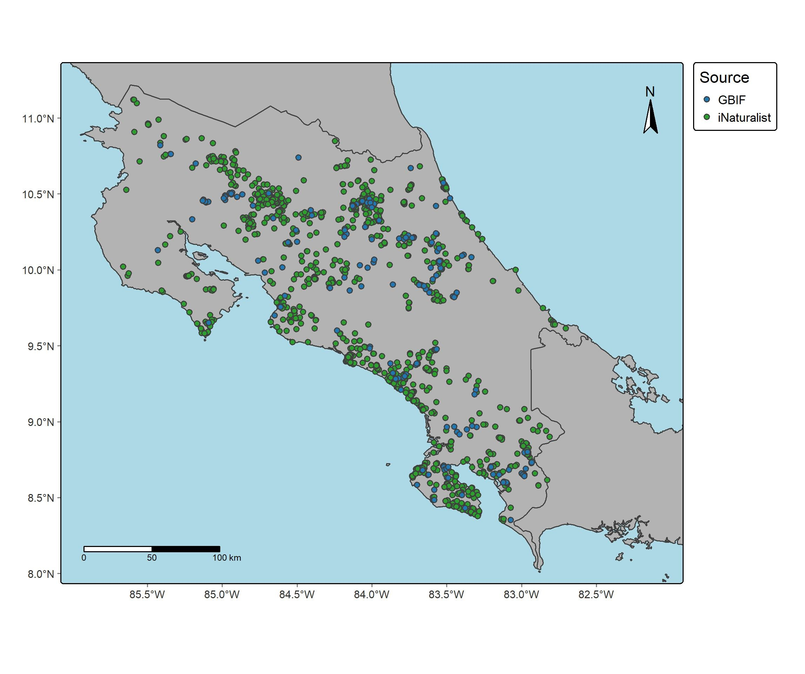

En esta práctica se utilizaron los paquetes rgbif y rinat para descargar ocurrencias de la especie de anuro *Craugastor fitzingeri* en Costa Rica. Para el ordenamiento de datos se utilizó el paquete Tidyverse y para la limpieza de datos espaciales se utilizó principalmente el paquete CoordinateCleaner. El mapeo de ocurrencia se realizó con los paquetes sf y tmap. El objetivo de esta práctica fue aprender a realizar la descarga de datos de ocurrencia de una especie desde una API y su posterior limpieza para crear un juego de datos robustos que puedan utilizarse en análisis espacial. En este ejercicio aprendí las bases de la importación de datos desde iNaturalist y GBIF; sin embargo,

Posterior a la limpieza, se construyó un juego de datos preliminar de 3760 ocurrencias, de las cuales 487 fueron de GBIF y 2456 provienen de iNaturalist (Figura 1).

Figura 1. Mapa de Costa Rica mostrando las ocurrencias de la especie *Craugastor fitzingeri* por fuente, a partir de los datos descargados desde las API de GBIF y de iNaturalist en el curso Ecología de Poblaciones y comunidades.

Con esta práctica aprendí a descargar registros de ocurrencia de una especie desde GBIF e iNaturalist, organizarlos y revisar sus coordenadas en R para representarlos un mapa. También comprendí que un mapa de ocurrencias muestra dónde se registró la especie, pero no necesariamente dónde fue más abundante, debido a que está limitado a los reportes y no a abundancias reales. De la misma forma, que no aparezcan puntos en una zona no significa que la especie no esté presente allí.

No encontré dificultades para esta práctica, gracias a que este procedimiento fue aprendido en cursos pasados, sin embargo, como recomendaciones, sugiero revisar muy bien las carpetas y correr el código de manera ordenada para evitar errores.

Este conocimiento es de gran utilidad porque se podría aplicar este procedimiento en un estudio de herpetofauna para comparar los sitios que visité en campo con los lugares donde ya existían registros de las especies estudiadas. Así podría identificar zonas poco documentadas y priorizar nuevas salidas de campo para averiguar si la falta de registros se debió a un menor esfuerzo de muestreo. O bien, para modelar la distribución de una especie de la que hay información nueva o simplemente que se quiere estudiar.
