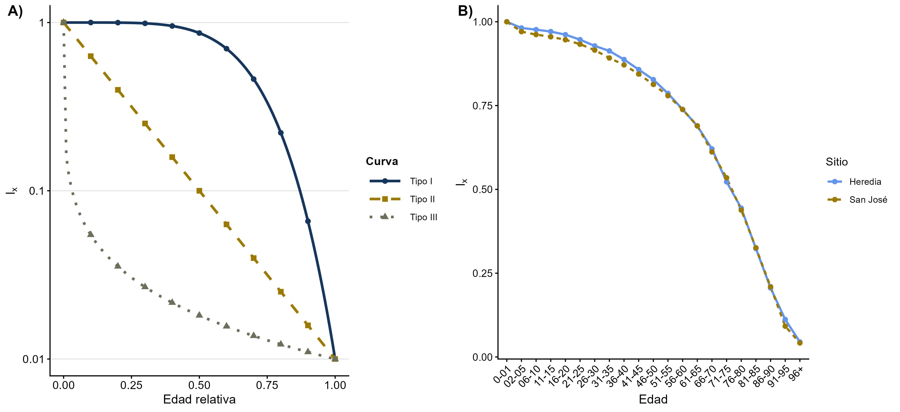
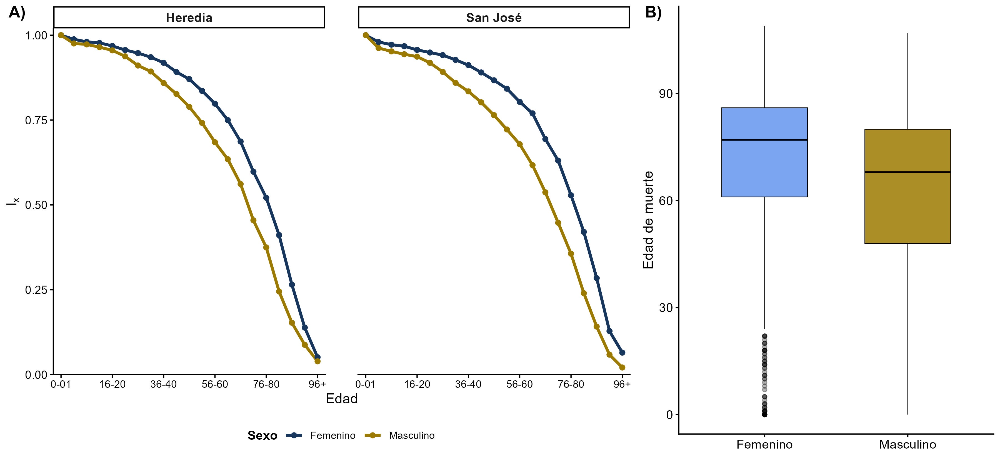
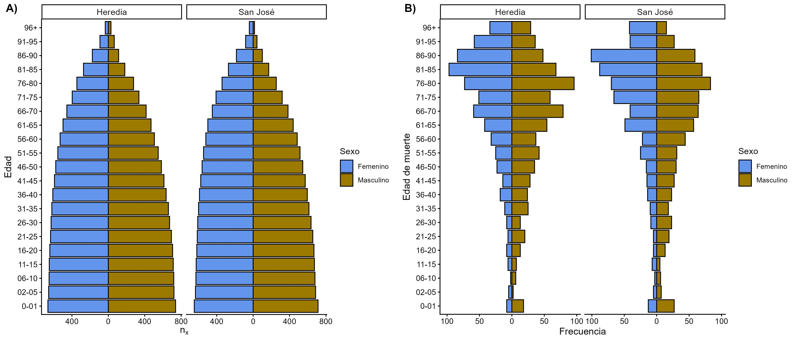

## Tablas de vida de dos poblaciones humanas 

En esta práctica se onstruyen tablas de vida y se interpretan curvas de supervivencia a partir de registros de los cementerios de Heredia y San José. Durante las dos giras de campo, se registraron en Epicollect5 el sexo y los años de nacimiento y defunción anotados en las tumbas. Luego, en RStudio, se combinaron los datos con tidyverse para calcular la edad al morir y se agrupó por intervalos de edad. Se usó gt para presentar las tablas y ggplot2 y cowplot para elaborar las figuras. El objetivo fue identificar a cuál de los tres patrones teóricos de supervivencia se parecían más las curvas obtenidas y evaluar si la distribución de las edades de muerte difería entre ambos cementerios.

Como resultado, se obtuvieron las curvas de supervivencia de ambios cementerios (Figura 1B) y se graficaron también las curvas teóricas de Tipo I, II y III para comparar (Figura 1A).

Figura 1. (A) Curvas teóricas de supervivencia de tipo I, II y III. (B) Curvas de supervivencia reconstruidas para Heredia y San José.

En la figura 1A se puede apreciar como ambas poblaciones, San José y Heredia, describen una curva de supervivencia de tipo I, caracterizada por una baja mortalidad durante los primeros años de vida y una mortalidad creciente conforme se alcanza mayor edad. Siendo la etapa de muerte principal, posterior a los 75 años de edad.

También, se obtuvieron las curvas de supervivencia por sexo (Figura 2A) para ambos sitios. En esta figura se demuestra que el comportamiento de la curva es semejante para ambos sexos, con una diferencia para los hombres, cuya curva empieza a decaer primero. La figura 2B contrarresta muy bien lo observado, donde se aprecia como los hombres suelen fallecer antes que las mujeres, al rededor de los 60 años de edad.

Figura 2. Supervivencia y edad al morir según el sexo en los registros de los cementerios de Heredia y San José. (A) Proporción de sobrevivientes por intervalo de edad y sexo en cada sitio. (B) Distribución de la edad al morir por sexo, con los registros de ambos sitios combinados.

Finalmente, se elaboraron pirámides de distribución de las edades de muerte por sexo y para ambos sitios, mostrando el número de sobrevivientes al inicio de cada intervalo (3A) y defunciones en cada intervalo (3B). En ambos sitios, el número de sobrevivientes de la cohorte reconstruida disminuyó con la edad (Figura 3A). Las defunciones registradas se concentraron en edades avanzadas. En los hombres, el mayor número de defunciones se registró entre los 76 y 80 años en ambos cementerios. En las mujeres, el intervalo con más defunciones fue de 81 a 85 años en Heredia y de 86 a 90 años en San José (Figura 3B).

Figura 3. Pirámides de sobrevivientes reconstruidos y defunciones registradas por intervalo de edad, sexo y sitio. (A) Número de sobrevivientes al inicio de cada intervalo. (B) Número de defunciones registradas en cada intervalo. En ambos paneles, el sexo femenino se muestra en color celeste y el masculino en color café claro.

Con esta práctica aprendí a construir una tabla de vida a partir de registros de defunción y a interpretar las curvas de supervivencia de Heredia y San José. Lo que más me costó fue distinguir entre el número de muertes registradas en un intervalo y la proporción de individuos que murió entre quienes habían llegado a esa edad. También comprendí que reconstruir una cohorte a partir de registros de cementerios no fue lo mismo que seguir a un grupo de personas desde su nacimiento. Podría aplicar este conocimiento en un proyecto de restauración ecológica, siguiendo plántulas marcadas para identificar en qué etapa ocurrieron más pérdidas y decidir cuándo reforzar el monitoreo.
