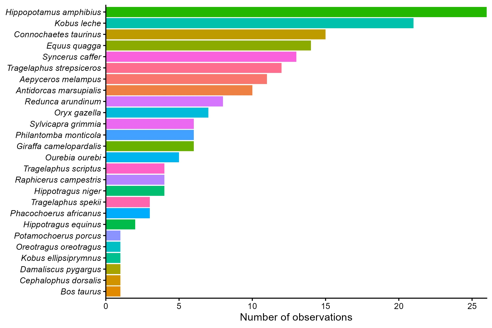

## Introducción

En esta práctica se utilizó el paquete Tidyverse en R para realizar el proceso de importación de datos, así como la limpieza, manipulación y visualización de datos. El juego de datos del estudio consistió en una serie de observaciones de mamíferos africanos que se encontraba desordenado o que carecía de formato. El objetivo de esta práctica fue importar, ordenar y visualizar un juego de datos de mamíferos africanos utilizando Tidyverse, que es una colección de paquetes de R diseñados para la ciencia de datos que comparten una filosofía, gramática y estructura de datos común. En este ejercicio aprendí las bases de importación, así como de limpieza de datos. Se importó un juego de datos y se realizó una manipulación de datos con Tidyverse que incluyó el resumen de datos, cambio de formato de fecha, unión y separación de columnas, y un gráfico para visualizar la abundancia de observaciones.

Se encontraron un total de 26 especies. La más abundante fue el hipopótamo, *Hipopotamus amphibius*, con 28 observaciones, seguido de el antílope *Kobus leche*, con 22 observaciones (Figura 1).

Figura 1. Abundancia relativa de mamíferos africanos en el juego de datos importado y procesado con Tidyverse en el curso de Ecología de Poblaciones y comunidades (2026).

Con esta práctica, aprendí a corregir errores básicos en una base de datos. Encontré la dificultad de comprender el tipo de datos, sentido y organización inicial de los datos, debido precisamente a la manera menos ordenada en que fueron entregados. Esto es útil para el manejo y gestión de cualquier base de datos de un estudio biológico, lo que me da las destrezas para manejar bases de datos de forma adecuada, ordenada y estandarizada para la comunidad científica. Esto facilita el análisis, manejo y reproducibilidad de los datos con los que trabaje.
